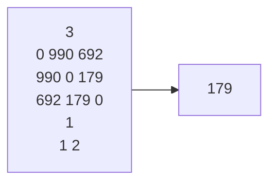

## 样例 



## 重点
核心：基于最小生成树的拓展，指定包含某些边，并基于此构造最小生成树  
思路：先将指定的数个边放在另一个数组，并在并查集中合并，这样就相当于加入了生成树，然后再执行生成树就好，所有生成树包含指定的数组与生成树两个数组  

## 错误
1. 题目说有多组数据，但不告诉有几组，用while：	while(cin>>G.vexnum )，这样输入直到eof
2. 当目标的方法与原有方法产生差异，避免修改原有方法，以下对特别定义的图进行了特别修改，当然也可以重载构造函数
```cpp
AMGraph G;
while(cin>>G.vexnum )
{
	//初始化边表
	G.arcs.resize(G.vexnum);
	for (int i = 0; i < G.vexnum; i++)
	{
		G.arcs[i].resize(G.vexnum);
		for (int j = 0; j < G.vexnum; j++)
		{
			
			cin >>G.arcs[i][j];
		}
	}
	Result re;
	kruskal(G, re);
	cout << re.sum << endl;
}
```
3. 构造：用花括号可以避免写构造函数比如Edge{u,v,w}

## 完整代码
```cpp
#include<iostream>
using namespace std;
#define MAXINT 32767
#include<vector>
#include<algorithm>

struct AMGraph
{
	vector<vector<int>>arcs;
	vector < int >vexs;
	int vexnum = 0, arcnum = 0;
};

void CreateAMGraph(AMGraph& G)
{
	int v,a;
	cin >> v;

	//填充G的顶点部分
	G.vexnum = v;
	G.vexs.resize(G.vexnum);
	for (int i = 0; i < G.vexnum; i++)
	{
		G.vexs[i] = i;
	}

	cin >> a;
	G.arcnum = a;
	//初始化边表
	G.arcs.resize(G.vexnum);
	for (int i = 0; i < G.vexnum; i++)
	{
		G.arcs[i].resize(G.vexnum);
		for (int j = 0; j < G.vexnum; j++)
		{
			int x;
			cin >> x;
			G.arcs[i][j]=x;

		}
	}
	
}

struct Pair
{
	int data1, data2;
	int wei;
	Pair(int d1,int d2,int w):data1(d1),data2(d2),wei(w){}
};
struct Result
{
	vector<Pair>arr;
	int sum = 0;
};

//定义一个并查集，名字含义是父，他是一个集合的代表人
vector<int>fa;

//寻找集合的代表人
int find(int x)
{
	//只有代表人的父是自己
	//if (fa[x] == x)
	//	return x;
	//else
	//{
	// //路径压缩，每个元素的父都改为代表人，使查询只需要一步
	//	fa[x] = find(fa[x]);
	//	return	fa[x];
	//}

	return fa[x] == x ? x : (fa[x] = find(fa[x]));
}

//合并两个集合
void merge(int x, int y)
{
	fa[find(y)] = find(x);
}

//为kruskal专门定义的类，存放所有边
struct Edge
{
	//u代表头，v代表尾
	int u, v, w;
	Edge(int u1,int v1,int w1):u(u1),v(v1),w(w1){}
};

//输入有几条路已建好
void repaired(const AMGraph&G, vector<Edge>&repairedone)
{
	//输入有几条路已修好，

	int n;
	cin >> n;
	while (n--)
	{
		int loc1,loc2;
		cin >> loc1 >> loc2;
		int wei = G.arcs[loc1 - 1][loc2 - 1];
		repairedone.push_back(Edge(loc1 - 1, loc2 - 1, wei));
		merge(loc1-1, loc2-1);
	}
}

bool cmp(const Edge& e1, const Edge& e2)
{
	return e1.w < e2.w;
}
void kruskal(const AMGraph& G, Result& re)
{
	//初始化fa数组
	fa.assign(G.vexnum, 0);
	for (int i = 0; i < G.vexnum; i++)
	{
		fa[i] = i;
	}

	vector<Edge>e;
	vector<Edge>reone;
	repaired(G,reone);

	//resize会填充0，然后可以用下标，如果不用下标填充反而多余
	//e.resize(G.arcnum);
	for (int i = 0; i < G.vexnum - 1; i++)
	{
		for (int j = i + 1; j < G.vexnum; j++)
		{
			int v = G.arcs[i][j];
			e.push_back(Edge(i, j, v));
		}
	}

	//测试边是否能加入
	//for (auto i : e)
	//{
	//	cout << i.u << " " << i.v << endl;
	//}

	sort(e.begin(), e.end(), cmp);
	
	for (auto& i : e)
		{
			if (find(i.u) != find(i.v))
			{
				merge(i.u, i.v);
				re.arr.push_back(Pair(i.u, i.v, i.w));
				re.sum += i.w;
			}
		}

	
}

void test01()
{
	AMGraph G;
	while(cin>>G.vexnum )
	{
		//初始化边表
		G.arcs.resize(G.vexnum);
		for (int i = 0; i < G.vexnum; i++)
		{
			G.arcs[i].resize(G.vexnum);
			for (int j = 0; j < G.vexnum; j++)
			{
				
				cin >>G.arcs[i][j];
			}
		}
		Result re;
		kruskal(G, re);
		cout << re.sum << endl;
	}
}
int main()
{

	test01();
	return 0;
}
//\b(?!if|for|return)(\w+)\s*\(
```
